# Diagramas UML · TactiVision IA

Diagramas del sistema completo (frontend, backend, servicio de IA y base de datos), escritos en
Mermaid para que GitHub los dibuje y se puedan editar como texto. Los nombres de clases y métodos son
los del código. El diagrama entidad-relación de la base de datos está en el repositorio
`TactiVisionSoccerIA-db`, en `docs/DICCIONARIO_DE_DATOS.md`.

1. [Casos de uso](#1-casos-de-uso)
2. [Despliegue](#2-despliegue)
3. [Componentes del backend](#3-componentes-del-backend)
4. [Clases: análisis de video](#4-clases-análisis-de-video)
5. [Clases: reportes y jugadas](#5-clases-reportes-y-jugadas)
6. [Clases: servicio de IA](#6-clases-servicio-de-ia)
7. [Clases: estructuras de datos](#7-clases-estructuras-de-datos)
8. [Estados de un análisis](#8-estados-de-un-análisis)
9. [Secuencia: analizar un video](#9-secuencia-analizar-un-video)
10. [Secuencia: iniciar sesión](#10-secuencia-iniciar-sesión)
11. [Secuencia: recuperar la contraseña](#11-secuencia-recuperar-la-contraseña)

## 1. Casos de uso

Tres actores humanos y uno externo (el servicio de IA, al que solo llama el backend).

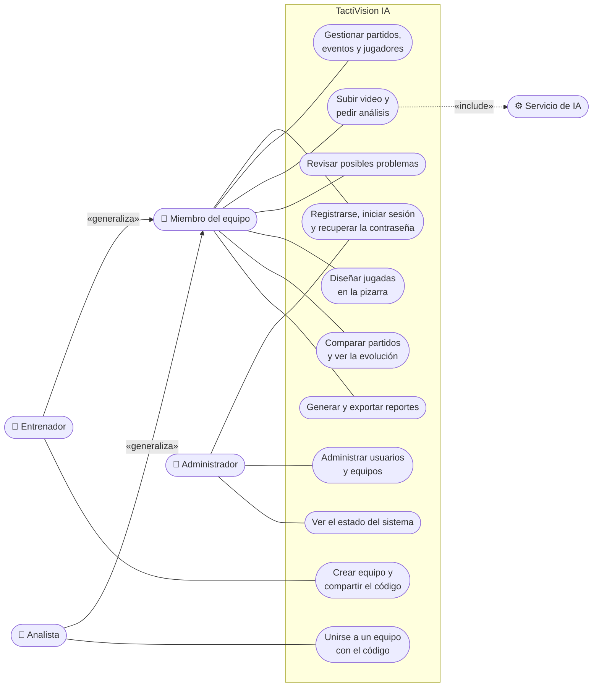

El administrador no tiene acceso al contenido táctico de ningún equipo: la API lo rechaza y, además,
Row-Level Security en PostgreSQL no le entrega esas filas.

## 2. Despliegue

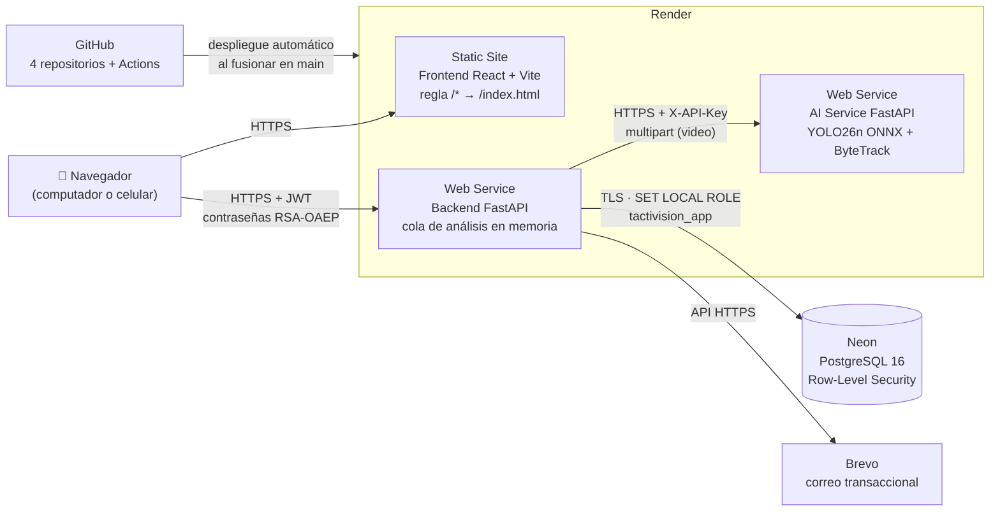

## 3. Componentes del backend

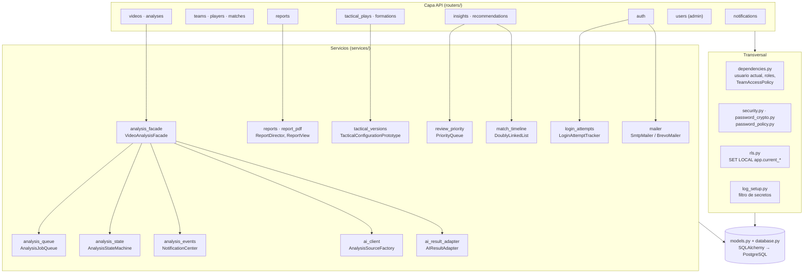

## 4. Clases: análisis de video

Facade, State, Observer, Singleton, Abstract Factory, Decorator y Adapter trabajando juntos en el
caso de uso más importante.

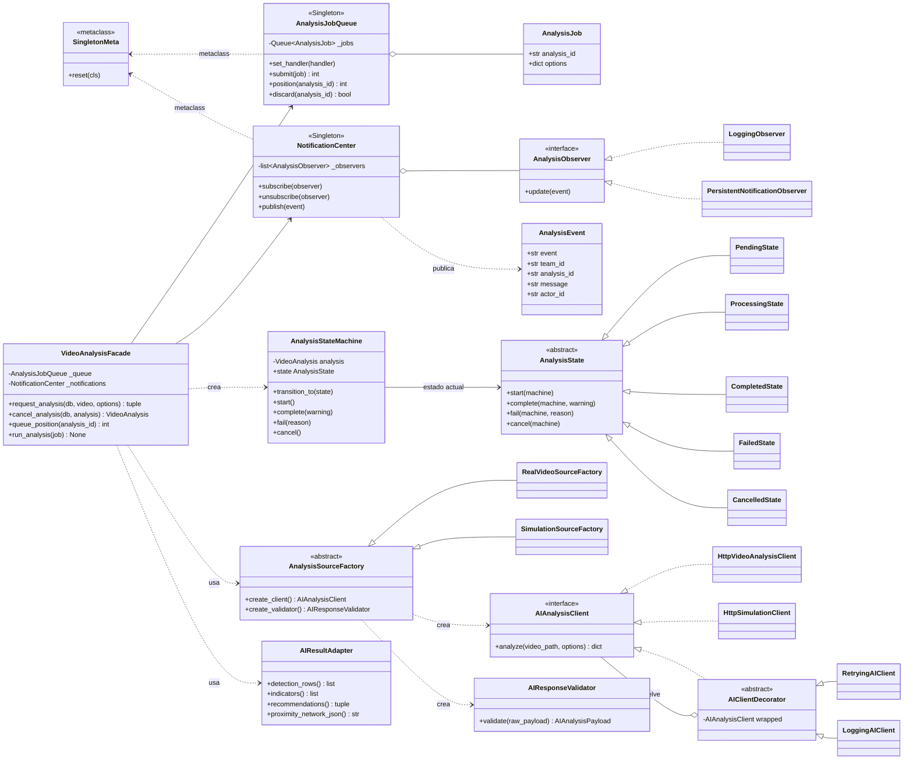

## 5. Clases: reportes y jugadas

Bridge (tipo de reporte × formato), Builder (el contenido del reporte por secciones) y Prototype
(cada versión de una jugada es un clon de la anterior).

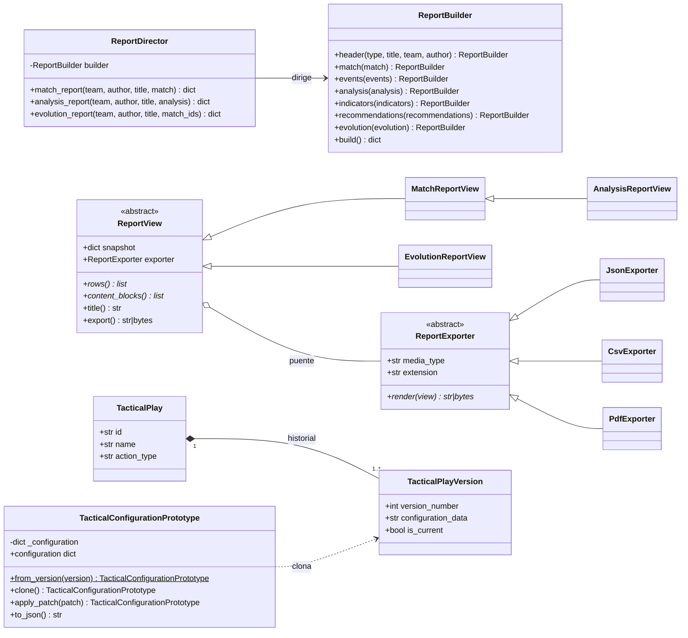

## 6. Clases: servicio de IA

Facade (`VideoAnalysisPipeline`), Factory Method (detector y tracker), Adapter (`ByteTrackTracker`
sobre la librería `supervision`) y Strategy (cada familia de indicadores).

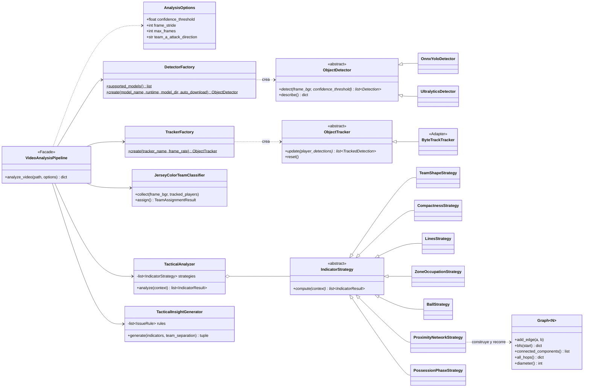

## 7. Clases: estructuras de datos

Implementadas a mano (no son las de la librería estándar) y cada una con sus pruebas.

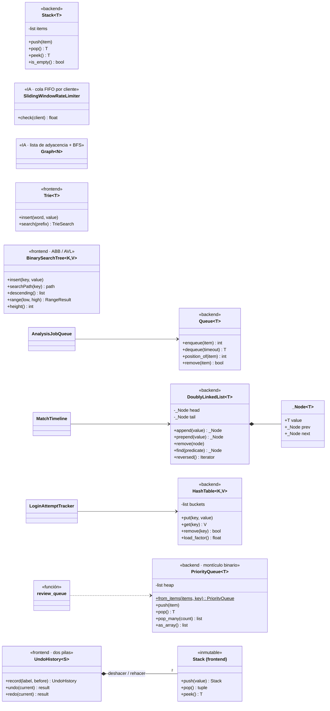

## 8. Estados de un análisis

Patrón State: cada estado decide qué transiciones acepta; una transición ilegal responde 409.

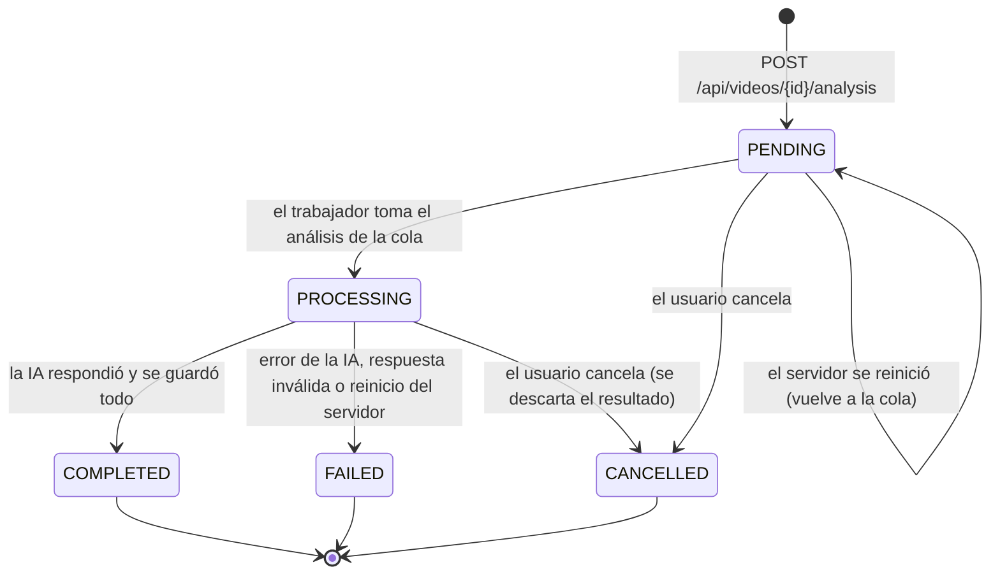

## 9. Secuencia: analizar un video

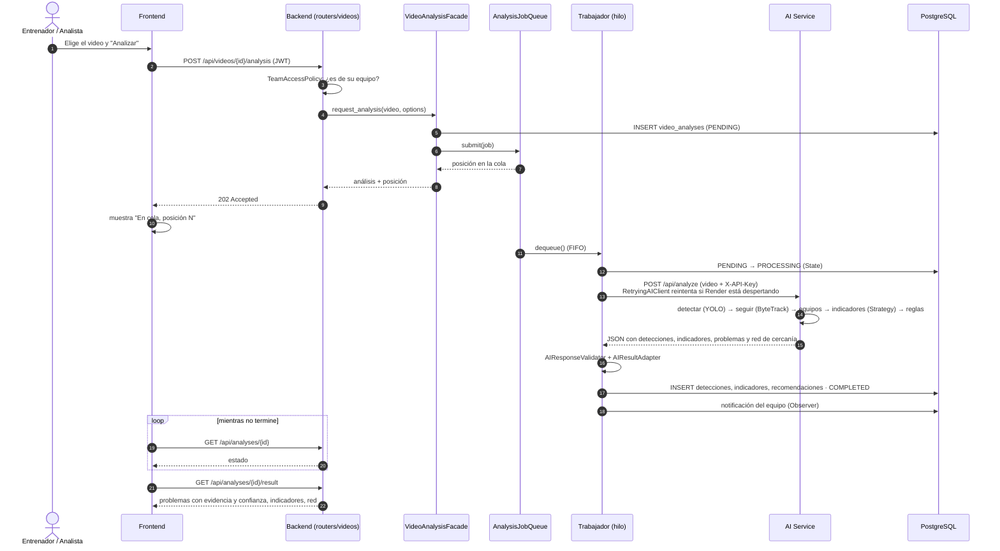

## 10. Secuencia: iniciar sesión

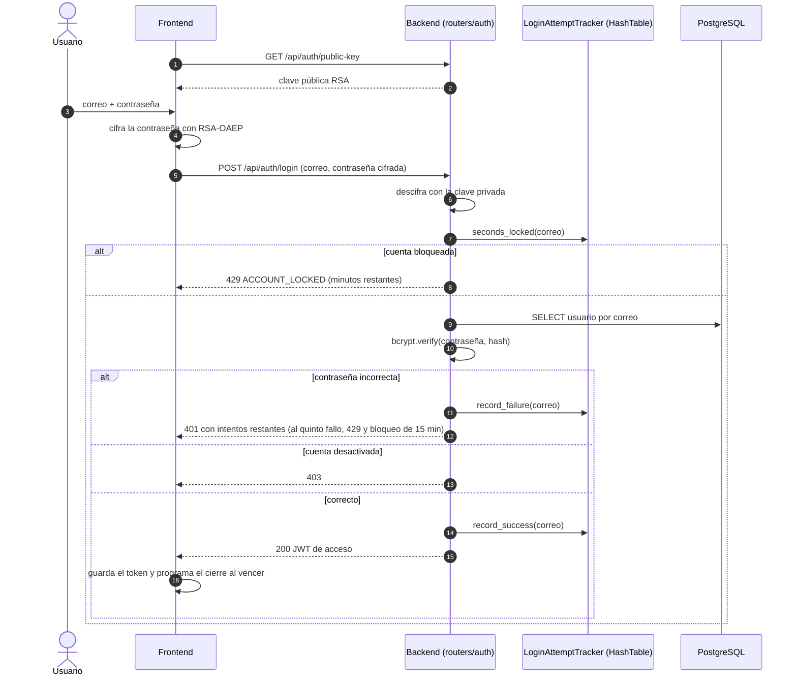

## 11. Secuencia: recuperar la contraseña

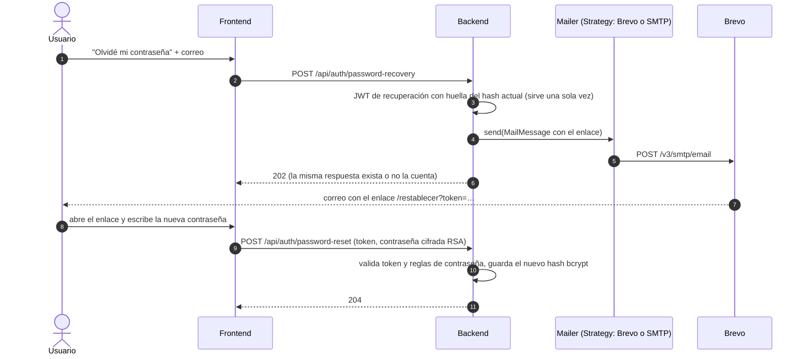
